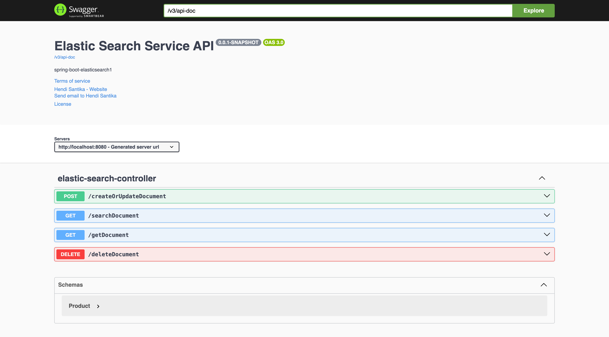

# spring-boot-elasticsearch1

[](https://github.com/hendisantika/spring-boot-elasticsearch1/actions/workflows/maven.yml)


Simple CRUD Product Store application using **Spring Boot**, **Spring Data Elasticsearch** (Elasticsearch Java API
Client), **Thymeleaf** UI and **Swagger UI** (springdoc-openapi).

## Tech Stack

| Component              | Version  |
|------------------------|----------|
| Java (JDK)             | 25       |
| Spring Boot            | 3.5.16   |
| springdoc-openapi      | 2.8.17   |
| Elasticsearch (Docker) | 8.16.1   |
| Maven (wrapper)        | 3.9.11   |

## Prerequisites

- JDK 25 (e.g. [Eclipse Temurin](https://adoptium.net/) 25)
- Docker & Docker Compose (to run Elasticsearch)
- Maven is optional — use the bundled Maven Wrapper (`./mvnw`)

## Things todo list

1. Clone this repository: `git clone https://github.com/hendisantika/spring-boot-elasticsearch1.git`
2. Navigate to the folder: `cd spring-boot-elasticsearch1`
3. Make sure you are using JDK 25: `java -version`
4. Start Elasticsearch (optional — `spring-boot-docker-compose` will start `compose.yaml` automatically on run):
   `docker compose up -d`
5. Run the application: `./mvnw clean spring-boot:run`
6. Open your favorite browser: http://localhost:8080
7. Open Swagger UI: http://localhost:8080/swagger-ui
8. OpenAPI docs: http://localhost:8080/v3/api-doc

## Build & Test

```shell
./mvnw clean verify
```

## REST API Endpoints

| Method   | Endpoint                       | Description                |
|----------|--------------------------------|----------------------------|
| `POST`   | `/createOrUpdateDocument`      | Create or update a product |
| `GET`    | `/getDocument?productId=ID`    | Get a product by id        |
| `DELETE` | `/deleteDocument?productId=ID` | Delete a product by id     |
| `GET`    | `/searchDocument`              | List all products          |

## Web UI (Thymeleaf)

| Path                       | Description              |
|----------------------------|--------------------------|
| `/`                        | Product list             |
| `/showNewProductForm`      | Add new product form     |
| `/showFormForUpdate/{id}`  | Update product form      |
| `/deleteProduct/{id}`      | Delete product           |

## CI/CD & Dependency Updates

- **GitHub Actions** — [`.github/workflows/maven.yml`](.github/workflows/maven.yml) builds and tests the project with
  Temurin JDK 25 on every push and pull request to `main`.
- **Dependabot** — [`.github/dependabot.yml`](.github/dependabot.yml) checks weekly (Monday 07:00 Asia/Jakarta) for
  updates of:
    - Maven dependencies (grouped: Spring Boot, springdoc, Elasticsearch, minor/patch)
    - GitHub Actions
    - Docker Compose images (Elasticsearch)

## Image Screenshot

Swagger UI



Add New Product Store


List Product Store


